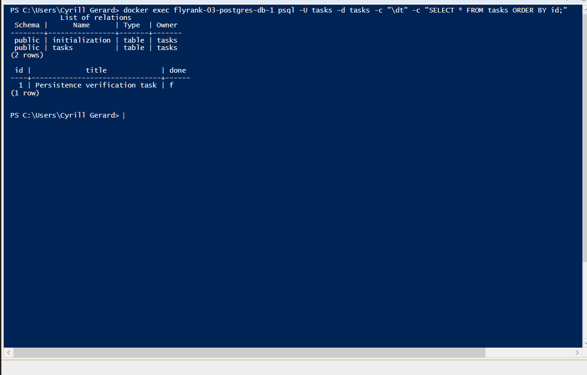

# W3 - Containerized PostgreSQL Task API

Python/FastAPI task CRUD backed by PostgreSQL 16. Docker Compose starts both services, and a named volume retains database data when the containers are recreated.

## Run

Install Docker Desktop and keep its engine running. Clone this repository and open a terminal in its directory. On Windows PowerShell, prepare the local environment file once:

```powershell
Copy-Item .env.example .env
```

On macOS/Linux, use `cp .env.example .env` instead. The example values are disposable local development defaults. The app reads `DATABASE_URL`; PostgreSQL reads `POSTGRES_USER`, `POSTGRES_PASSWORD` and `POSTGRES_DB`. Keep the username, password and database in the URL consistent with the other three variables. Inside Compose, the database hostname is `db`.

Start the whole stack with one command:

```sh
docker compose up
```

Compose builds the image on the first run, waits for the database healthcheck, creates the table and seeds three example tasks. Open http://localhost:8000/docs for Swagger UI or http://localhost:8000/tasks for the task list. After changing code, run `docker compose up --build` to rebuild.

| Method | Path | Purpose |
|---|---|---|
| GET | /, /health | API information and health |
| GET | /tasks, /tasks/{id} | List or read |
| POST | /tasks | Create with `{"title":"Buy milk"}` |
| PUT | /tasks/{id} | Update `title` and/or `done` |
| DELETE | /tasks/{id} | Delete |

Missing or invalid input returns 400; unknown task IDs return 404.

## Storage and configuration

PostgreSQL data is stored in the named `postgres_data` volume. `init.sql` creates the task table on a new database volume. The repository also creates it if missing, then seeds Learn APIs, Read a book and Take a walk only if the task table is empty and has never been initialized. An initialization marker prevents examples returning after deliberate deletion. Existing rows are preserved without adding examples.

The app and routes are byte-identical to the SQLite assignment; only the repository is replaced, with deployment configuration and initialization added. Every database query lives in `repository.py`, and user-supplied SQL values are parameterized. A separately named service layer is not required by this PDF; it identifies layered architecture as a later assignment.

`.env` is ignored by both Git and the Docker build context. `.env.example` is committed. The audit found no `.env` file in Git history and confirmed `/app/.env` was absent from the built app image.

## Persistence verification

To verify persistence: create a task, run `docker compose down`, run `docker compose up -d`, and retrieve the task with `GET /tasks`. Do not add `-v`, which removes the volume.

Verified on 2026-11-05 using Docker Desktop: `POST /tasks` returned 201 with `{"id":1,"title":"Persistence verification task","done":false}`. After `docker compose down` removed both app and database containers and `docker compose up -d` recreated them, `GET /tasks/1` returned 200 with the same row. The named PostgreSQL volume retained the data.

The [complete verification transcript](verification.txt) records a second check on 2026-11-05 against a clean Git clone and a separate Compose project/volume. Only the host port was overridden to 8007 because the existing stack occupied 8000. With Docker's base image/build cache already available, build/start/seed took 8.6 seconds. A fresh volume produced exactly three examples; three app-container restarts kept exactly those rows. A fourth task was created and marked done, then both containers were removed with `down` and recreated with `up -d`. New container IDs were confirmed, and the updated task survived. It was then deleted successfully with an empty 204 response. Invalid bodies returned 400; missing IDs returned 404.

The existing local project still contains its original persistence-verification row. It is not backfilled with examples: three-row seeding is a first-run behavior for an empty database.

## Actual curl output

Captured from the isolated verification stack after full-stack recreation:

```text
$ curl.exe -i http://localhost:8007/tasks
HTTP/1.1 200 OK
date: Thu, 05 Nov 2026 07:04:27 GMT
server: uvicorn
content-length: 201
content-type: application/json

[{"id":1,"title":"Learn APIs","done":false},{"id":2,"title":"Read a book","done":false},{"id":3,"title":"Take a walk","done":false},{"id":4,"title":"Postgres full-stack persistence check","done":true}]
```

## Database inspection

Run this command from the repository directory to display the tables and stored task data:

```sh
docker compose exec -T db psql -U tasks -d tasks -c "\dt" -c "SELECT * FROM tasks ORDER BY id;"
```

If you changed the example username or database, replace the two `tasks` arguments accordingly. The verification transcript includes actual `psql` output. The screenshot below shows this inspection against the existing local PostgreSQL container: both tables are listed, and the original persistence-verification task is present. Fresh-volume three-row seeding was verified separately, as recorded above.



## Tests

Run the four real PostgreSQL integration tests in a disposable app container:

```sh
docker compose run --rm app sh -c "pip install -r requirements-dev.txt && python -m pytest -q"
```

Each test uses a temporary PostgreSQL schema, which is removed afterward, so existing tasks are not modified. The tests cover the HTTP CRUD cycle, three-row first-run seeding and repeated initialization, preservation of an existing task table, and intentional deletion without reseeding. All four passed during this audit. The installed FastAPI/Starlette version emitted a TestClient deprecation warning about its httpx dependency; it did not affect these results.

## Submission history

This assignment has a separate repository, following the supplied instructor Q&A allowing either a new repository or continuation of the earlier one. The original development stages were not committed individually. The history records actual implementation and verification work; later commits do not reconstruct an original stage-by-stage history.
